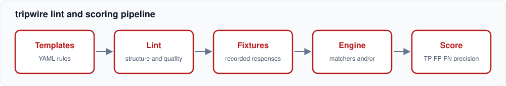

<p align="center"></p>

# tripwire

> Lint YAML detection templates and score their precision against local vulnerable fixtures.

[](https://github.com/AbnormalityAI/tripwire/actions/workflows/ci.yml)

[](LICENSE)


Writing a detection template is easy. Knowing whether it fires on the right things, and only those, is the hard part. `tripwire` loads community-style YAML templates, lints them for common mistakes, then runs each one against a directory of **intentionally vulnerable fixtures and look-alike safe ones** and reports a confusion matrix per template.

Inspired by the template format popularised by [projectdiscovery/nuclei](https://github.com/projectdiscovery/nuclei). It is not a scanner: nothing touches the network. Fixtures are recorded responses with ground truth attached.

## Features

- Template schema with `word`, `regex` and `status` matchers, `part: header|body`, `negative`, and `and`/`or` conditions at matcher and template level
- Strict YAML: unknown keys, empty files and multiple documents per file are errors; missing or empty template and fixture directories fail instead of passing silently
- Linter rules: matcher and template `condition` values, id format, duplicates, severity enum, missing name or tags, invalid or over-broad regex, words under 4 chars, status-only and all-negative templates
- Scoring harness: TP/FP/FN/TN, precision, recall, and names of the fixtures behind each false positive or miss
- CI gating with `-min-precision` and `-min-recall`
- Ground-truth typo check: a fixture expecting an unknown template id fails the run
- Ships six example templates and nine fixtures, including one deliberately sloppy template that the harness catches

## Quickstart

```sh
# from a checkout
git clone https://github.com/AbnormalityAI/tripwire && cd tripwire
go run ./cmd/tripwire lint -t templates
go run ./cmd/tripwire score -t templates -f fixtures
go run ./cmd/tripwire score -min-precision 0.95 -min-recall 0.95   # non-zero exit if any template falls short
# or, once published: go install github.com/AbnormalityAI/tripwire/cmd/tripwire@latest
```

Example output:

```
template                      TP  FP  FN  TN  precision recall
debug-stacktrace               2   0   0   7       1.00   1.00
exposed-env-file               1   0   0   8       1.00   1.00
sloppy-admin-panel             1   1   0   7       0.50   1.00
    false positive on blog-about-admin
```

A template:

```yaml
id: exposed-env-file
info: {name: Exposed .env file, severity: high, tags: [exposure, config]}
matchers-condition: and
matchers:
  - type: status
    status: [200]
  - type: regex
    regex: ['(?m)^[A-Z][A-Z0-9_]*(SECRET|PASSWORD|API_KEY|TOKEN)[A-Z0-9_]*=\S+']
```

A fixture:

```yaml
name: env-example-doc
status: 200
body: "<p>Create a file with DB_PASSWORD=your-password-here in a .env</p>"
expect: []          # a safe look-alike: no template should fire
```

## Architecture



- `template.go` loads templates and fixtures with strict decoding.
- `lint.go` is pure: templates in, findings out. Errors fail the run, warnings do not.
- `engine.go` evaluates matchers against a fixture. A template with no matchers never fires.
- `harness.go` compares fired versus `expect` for every template and fixture pair.

## Known limitations

- Static fixtures only. No live HTTP, DSL, extractors, workflows or payload fuzzing.
- Only three matcher types so far.
- Scores are only as good as the fixture set; a template can score 1.00 on a small corpus. Add safe look-alikes.
- `score` exits 1 on the bundled sloppy example by design (it demonstrates the failure mode). CI uses a lower precision floor.

## Roadmap

- [ ] `dsl` matcher with a small expression language
- [ ] Extractors and a report of what each template captured
- [ ] Serve fixtures from a local HTTP server for end-to-end runs
- [ ] SARIF output for the linter
- [ ] Fixture generator that mutates a positive into near-miss negatives

## License

MIT, see [LICENSE](LICENSE).
